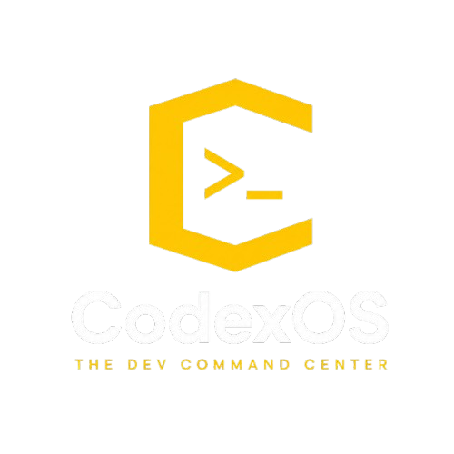

<div align="center">
  
  
  # CodexOS

  **Offline Developer Environment and Native System Control Center**  
  A high-performance, deeply integrated system explorer built with Rust, Tauri 2.0, and React 19.

  [](https://github.com/CodeSorcerer-007/CodexOS/releases)
  [](https://tauri.app/)
  [](https://react.dev/)
  [](https://www.rust-lang.org/)
  [](https://www.typescriptlang.org/)
  [](https://mistral.ai/)
  [](./LICENSE)
</div>

<br/>

**CodexOS** is a modern desktop developer environment and system control center engineered for performance, local privacy, and deep native operating system integration. Built on **Tauri 2.0 (Rust)** rather than Electron to eliminate runtime memory overhead, CodexOS combines native system performance with a responsive React 19 interface.

> [!NOTE]
> **Offline-First and Cross-Platform Architecture**: CodexOS operates entirely locally on Windows, macOS, and Linux without mandatory cloud accounts, telemetry, or external network dependencies.

---

## Table of Contents

- [Core Features](#core-features)
- [AI Root-Cause Copilot](#ai-root-cause-copilot)
- [Technology Stack](#technology-stack)
- [System Architecture](#system-architecture)
- [Documentation](#documentation)
- [Installation](#installation)
- [Building from Source](#building-from-source)
- [Contributing](#contributing)
- [Project Structure](#project-structure)
- [Security and Privacy Guarantees](#security-and-privacy-guarantees)
- [License](#license)

---

## Core Features

CodexOS provides native system utilities and developer tooling executing directly on local hardware:

### File and System Management

| Module | Description |
|---|---|
| **File Vault** | High-performance file explorer featuring Microsoft Fluent UI icons, quick access pinning, Git status indicators, batch regex renaming, duplicate detection, and disk treemap visualization. |
| **Visual Git Client** | Offline Git client with interactive commit and branch graphs, index staging, history viewer, visual diffs, stash management, cloning, and remote synchronization. |
| **Terminal Multiplexer** | Concurrent multi-tab shell sessions powered by native Rust PTY bridges (`powershell.exe` on Windows; `/bin/bash` or `zsh` on Unix-like platforms). |
| **Gridline Dashboard** | High-density dashboard for real-time system telemetry, pinned directories, recent projects, and quick action execution. |
| **Process Manager** | Real-time system process monitor with CPU and memory utilization telemetry, sorting, and graceful process termination. |
| **Environment Manager** | Workspace environment variable editor with `.env` syntax parsing, inline key masking, and unencrypted export safety warnings. |
| **Remote SSH Manager** | Secure remote server file explorer and terminal manager built on OpenSSH CLI wrappers with host key verification. |

### Security and Networking

| Module | Description |
|---|---|
| **Secrets Manager** | Encrypted in-memory secrets vault powered by ChaCha20-Poly1305 AEAD with runtime command secret injection. |
| **HMAC Commitment Vault** | Cryptographically signed key-value vault utilizing HMAC-SHA256 commitment verification. |
| **Proxy Interceptor** | Local HTTP and TCP traffic inspector, debugger, and request replay engine built on Hyper with an enterprise SSRF firewall. |
| **Port Tunneling** | Secure local port forwarding and reverse proxy tunneling powered by Serveo. |

### Developer Tooling and Diagnostics

| Module | Description |
|---|---|
| **Docker Dashboard** | Local Docker container, image, and network manager with real-time log streaming and container lifecycle controls. |
| **Database Studio** | SQLite visual management console with schema inspection, query execution, and tabular dataset analysis. |
| **Local AI Copilot** | Offline LLM assistant connecting directly to local Ollama instances with zero external API dependencies and zero telemetry. |
| **AI Root-Cause Copilot** | Autonomous diagnostics engine that inspects terminal errors, memory anomalies, and HTTP failures via Mistral AI. |
| **GPU Telemetry** | Real-time GPU utilization, VRAM allocation metrics, and hardware performance tracking. |
| **Memory Profiler** | Real-time process memory delta tracking and resource leak diagnostics. |
| **AST Refactor Engine** | Semantic code refactoring and syntax tree explorer powered by WebAssembly Tree-sitter. |
| **Collaborative Editor** | Peer-to-peer real-time collaborative editing using CRDTs (Yjs), WebRTC data channels, and the Monaco Editor. |
| **WASM Runtime (Nano-VMs)** | Sandboxed WebAssembly and WASI plugin execution engine powered by Wasmtime. |
| **Plugin Manager** | Modular plugin runner and extension management interface. |
| **Automation Studio** | Visual node-based workflow builder (ReactFlow) for automating routine developer workflows. |
| **DevDocs Viewer** | Instant offline documentation browser for developer languages, frameworks, and APIs. |

---

## AI Root-Cause Copilot

> [!IMPORTANT]
> **Autonomous Diagnosis**: The AI Root-Cause Copilot inspects diagnostic events across your development environment using **Mistral AI** (`mistral-large-latest`). This capability is opt-in, inactive when an API key is not configured, and persists keys exclusively within Rust's encrypted memory vault.

```
Terminal Exit != 0 ──┐
Memory Spike Delta  ──┼──► Rust Context Gatherer ──► Mistral API ──► Dismissible Diagnosis Card
HTTP 4xx / 5xx Error──┘
```

### Key Capabilities

- **Automatic Detection**: Intercepts non-zero terminal exit codes, Git diffs (up to 8 KB), system metric anomalies, and HTTP error traces.
- **Confidence Metrics**: Computes High, Medium, or Low confidence ratings accompanied by detailed diagnostic rationales.
- **Actionable Fixes**: Generates validated shell commands and source patches formatted for review and direct application.
- **Source Navigation**: Provides deep links that navigate directly to relevant source files and line ranges.

---

## Technology Stack

### Frontend

| Technology | Version | Purpose |
|---|---|---|
| **React** | 19 | Declarative user interface framework |
| **Vite** | 8 | Build tooling and development server |
| **TypeScript** | 6.0 | Strict static type checking |
| **Zustand** | 5 | Modular state management with domain slices |
| **Framer Motion** | 12 | Interface transitions and motion primitives |
| **Tailwind CSS** | 4 | Utility-first styling system |
| **Monaco Editor** | 0.56 | In-browser code editing engine |
| **Fluent UI Icons** | 2.0 | Standardized file and directory iconography |
| **ReactFlow** | 12 | Node-based workflow graphs |
| **Recharts** | 3 | Hardware telemetry and treemap visualization |
| **Yjs + WebRTC** | 13 / 10 | Real-time CRDT peer-to-peer synchronization |
| **xterm.js** | 6 | Terminal emulation with ANSI color support |

### Backend (Rust / Tauri 2.0)

| Component | Purpose |
|---|---|
| **Tauri 2.0** | Secure native application shell and capability-based IPC bridge |
| **portable-pty** | Cross-platform native PTY session manager |
| **Git CLI (`cli_runner`)** | Native Git CLI execution wrapper with argument sanitization |
| **OpenSSH CLI (`cli_runner`)** | Hardened OpenSSH execution harness with host key verification |
| **rusqlite** | SQLite persistence for database studio and local key-value storage |
| **sysinfo** | Real-time CPU, RAM, disk, and process telemetry |
| **wasmtime** | Sandboxed WebAssembly and WASI runtime |
| **ring / chacha20poly1305** | Authenticated encryption (AEAD) and HMAC verification |
| **hyper / tokio** | Asynchronous HTTP proxy interceptor with SSRF firewall |
| **reqwest** | Asynchronous HTTP client for diagnostic services |

---

## System Architecture

- **Multi-Tab Workspace**: Run up to 8 concurrent workspace tabs (`Ctrl+1..8`) with isolated state and persistence.
- **Lazy-Loaded Modules**: Every tool is dynamically imported via `React.lazy` and `Suspense`, maintaining sub-100ms initial startup.
- **Resilient UI Boundaries**: Global React Error Boundaries isolate crashes so individual module errors do not compromise application stability.
- **Typed Rust IPC**: All filesystem, Git, networking, and cryptographic operations execute in Rust with type-safe Tauri 2 `invoke` handlers validated at runtime via Zod schemas.

For comprehensive architectural specifications, refer to [ARCHITECTURE.md](./ARCHITECTURE.md).

---

## Documentation

Comprehensive technical documentation is maintained in the [`docs/`](./docs/README.md) directory:

- **[System Architecture Guide](./ARCHITECTURE.md)**: Layer responsibilities, security threat model, and SQLite data durability.
- **[IPC API Reference](./docs/API_REFERENCE.md)**: Exhaustive catalog of all 129 Tauri IPC commands and security invariants.
- **[Architectural Decision Records (ADRs)](./docs/adr/README.md)**: Historical record of foundational design choices.
- **[Enterprise Code Signing Runbook](./docs/ENTERPRISE_GA_SIGNING.md)**: Production code signing, notarization, and auto-updater setup.
- **[Version Comparison Report](./docs/V1_VS_V2_COMPARISON.md)**: Deep architectural comparison and hardening analysis between v1 and v2.
- **[Security Policy](./SECURITY.md)**: Vulnerability disclosure policies and supported versions.
- **[Contributing Guide](./CONTRIBUTING.md)**: Code standards, PR guidelines, and verification requirements.

---

## Installation

Pre-compiled binary packages are available for Windows, macOS, and Linux:

### Option 1: Direct Download

Download official release packages from [GitHub Releases](https://github.com/CodeSorcerer-007/CodexOS/releases/latest):
- **[Windows (.msi / .exe)](https://github.com/CodeSorcerer-007/CodexOS/releases/latest)**
- **[macOS (.dmg / .app)](https://github.com/CodeSorcerer-007/CodexOS/releases/latest)**
- **[Linux (.AppImage / .deb)](https://github.com/CodeSorcerer-007/CodexOS/releases/latest)**

### Option 2: Windows Package Manager (`winget`)

```powershell
winget install CodeSorcerer.CodexOS
```

### Option 3: PowerShell Automated Installer

```powershell
iwr -useb https://raw.githubusercontent.com/CodeSorcerer-007/CodexOS/main/install.ps1 | iex
```

---

## Building from Source

### Prerequisites

- [Rust](https://rustup.rs/) (version 1.77 or higher)
- [Node.js](https://nodejs.org/) (version 20 LTS or higher)
- Platform toolchain: Visual Studio C++ Build Tools (Windows) or standard build-essential / Xcode Command Line Tools (Linux / macOS)

### Clone and Run

```bash
# 1. Clone the repository
git clone https://github.com/CodeSorcerer-007/CodexOS.git
cd CodexOS

# 2. Install dependencies
npm install

# 3. Launch Tauri development server (Frontend + Rust backend with hot-reload)
npm run tauri dev
```

### Quality Assurance and Packaging

```bash
# Run linter (oxlint)
npm run lint

# Run frontend test suite (Vitest)
npm test

# Run TypeScript type check
npx tsc -b

# Run Rust backend unit and integration tests
cd src-tauri && cargo test

# Build production installer
npm run tauri build
```

---

## Contributing

Contributions are welcomed. Please review the **[Contributing Guide](./CONTRIBUTING.md)** prior to opening a pull request:
- Branch naming conventions (`feat/<topic>`, `fix/<topic>`)
- [Conventional Commits](https://www.conventionalcommits.org/) standards
- Frontend and backend testing requirements
- Pull request submission checklist

---

## Project Structure

```
CodexOS/
├── src/                          # React 19 Frontend
│   ├── App.tsx                   # App shell, tab manager, shortcut listeners
│   ├── components/               # Core feature modules (lazy-loaded)
│   │   ├── FileGrid/             # Modular file vault (Context, Main, Toolbar, Treemap, Duplicates)
│   │   ├── VisualGit.tsx         # Offline visual Git client
│   │   ├── TerminalMultiplexer.tsx # Multi-session PTY terminal
│   │   ├── SecretsManager.tsx    # ChaCha20-Poly1305 encrypted vault
│   │   ├── HMACVault.tsx         # HMAC-SHA256 commitment vault
│   │   ├── DockerDashboard.tsx   # Container & image manager
│   │   ├── DatabaseStudio.tsx    # SQLite query studio
│   │   ├── NetworkInterceptor.tsx# HTTP/TCP proxy debugger
│   │   ├── CollaborativeEditor.tsx # Yjs + WebRTC peer editor
│   │   ├── LocalAI.tsx           # Ollama local LLM interface
│   │   ├── ASTRefactor.tsx       # Tree-sitter semantic refactoring
│   │   ├── GPUCluster.tsx        # GPU utilization monitor
│   │   ├── MemoryProfiler.tsx    # Process memory delta analyzer
│   │   ├── ProcessManager.tsx    # System process monitor & manager
│   │   ├── EnvManager.tsx        # .env workspace manager
│   │   ├── SshManager.tsx        # Remote SSH file & session manager
│   │   ├── PortTunnel.tsx        # Serveo port forwarding
│   │   ├── DiagnosisCard.tsx     # AI Root-Cause Copilot overlay
│   │   └── SettingsPage.tsx      # System & AI Copilot configurations
│   ├── gridline-dashboard/       # Modern high-density dashboard UI
│   ├── store/                    # Zustand modular state slices
│   ├── hooks/                    # Reusable hooks (keyboard shortcuts, PTY)
│   └── lib/                      # Shared frontend utilities
├── src-tauri/                    # Rust 2.0 Backend
│   ├── src/
│   │   ├── lib.rs                # App entrypoint & Tauri setup
│   │   ├── commands.rs           # Central registry of all 129 IPC commands
│   │   ├── files.rs              # Canonical filesystem sandboxing
│   │   ├── git.rs                # Native Git CLI operations
│   │   ├── multiplexer.rs        # PTY session management
│   │   ├── secrets.rs            # In-memory ChaCha20 encrypted vault
│   │   ├── hmac_vault.rs         # HMAC commitment proof vault
│   │   ├── proxy.rs              # Async HTTP/TCP proxy engine & SSRF firewall
│   │   ├── kv.rs                 # Decoupled SQLite key-value persistence
│   │   ├── ai.rs                 # AI Copilot + Ollama integration
│   │   ├── sys.rs / system_tools.rs # System telemetry & process tools
│   │   ├── docker.rs             # Docker engine socket bridge
│   │   ├── db.rs                 # SQLite runner
│   │   ├── ssh.rs                # OpenSSH remote filesystem client
│   │   ├── tunnel.rs             # SSH reverse tunneling
│   │   └── plugin.rs             # Wasmtime sandboxed runner
│   └── Cargo.toml
├── docs/                         # Technical documentation suite
│   ├── README.md                 # Documentation portal & index
│   ├── API_REFERENCE.md          # 129 Tauri IPC command reference
│   ├── ENTERPRISE_GA_SIGNING.md  # Production signing & updater runbook
│   ├── V1_VS_V2_COMPARISON.md    # Architecture & security evolution report
│   └── adr/                      # Architectural Decision Records
├── CONTRIBUTING.md               # Contribution standards and PR guidelines
├── ARCHITECTURE.md               # Deep architectural documentation
├── CHANGELOG.md                  # Semantic release history
├── SECURITY.md                   # Security policy & disclosure process
└── package.json
```

---

## Security and Privacy Guarantees

- **Local Execution**: All file operations, process monitoring, and developer tool chains execute entirely on local hardware without telemetry or mandatory cloud connections.
- **Isolated AI Credentials**: External API credentials (such as `MISTRAL_API_KEY`) reside exclusively within an in-memory ChaCha20-Poly1305 vault inside the native Rust process and are never accessible to the JavaScript runtime.
- **Sandboxed Extensions**: WebAssembly plugins execute within Wasmtime environments with zero host permissions by default.
- **Strict Content Security**: Hardened Content Security Policy prevents unauthorized remote script execution and untrusted network origins.
- **Enterprise SSRF Firewall**: Outbound proxy requests filter RFC-1918 private subnets, loopback, CGNAT, link-local/ULA, and cloud provider metadata endpoints.

---

## License

CodexOS is open-source software licensed under the [MIT License](./LICENSE).

<div align="center">
  <br/>
  <b>Built for developers who value performance, privacy, and control.</b>
</div>
